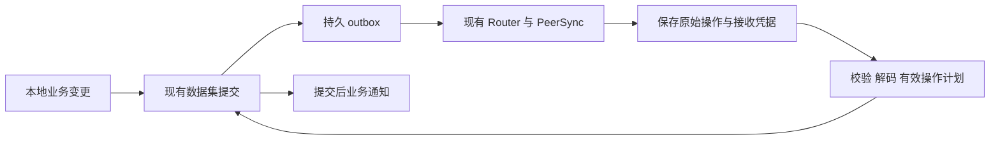

# 偏好同步重放审查与精简

日期：2026-10-22。

范围：模型配置错误、偏好同步的职责划分和本次结构修改。本文区分已修改内容与后续审查项；不把整个同步系统的重新设计算作已完成。

## 1. 判断

现有传输、接收凭据和数据集原子提交可以保留。确定存在的错误在于偏好物化器没有正确组合“完整赋值”和“字段修改”的语义。

同步日志包含完整条目赋值、完整条目删除、整数增量、对象补丁和旧格式 JSON 路径修改。完整赋值和删除会结束同一条目此前操作对最终值的影响。原实现仍清空条目后执行全部操作，要求已经被后续赋值覆盖的字段修改也拥有一个可执行的历史根对象。

修复应发生在通用操作组合规则中。该规则适用于所有偏好 owner，与 provider 名称、平台和本地存储版本无关。

## 2. 实际证据

上一步只读检查的 Windows 数据中，当前文件存在 `provider_DEEPSEEK`。两端已保存的日志中，字段修改早于完整 provider 赋值：

| 已存历史 | 早期字段修改 | 完整条目赋值 |
| --- | --- | --- |
| Windows | 2026-09-14，来源序号 7 | 2026-10-14，来源序号 6735 |
| Android | 2026-09-20 的字段修改 | 2026-10-14，来源序号 6735 |

上述日期使用北京时间，仅用于描述样本。覆盖判定使用已经确定的操作重放顺序和明确的完整赋值语义。

`initializeReplicationUnlocked` 发现历史已有完整赋值，所以不导入该条目的现存值。`applyDeclaredOperations` 随后删除该条目，并先执行早期字段修改，因此报缺少根对象。较晚的完整赋值尚未执行到。

## 3. 本次实现的语义

对同一个条目 k：

- `Set(k, value)` 建立一个完整的新值；此前针对 k 的修改不再影响最终值。
- `Delete(k)` 建立一个明确的删除结果；此前针对 k 的修改不再影响最终值。
- 整数增量、对象补丁和 JSON 路径修改，在最近一次完整赋值或删除之后保留其原有顺序。
- 后续操作依赖不存在的根对象，依然是失败的数据集事务。

执行过程：

1. 校验原始操作身份、载荷格式与版本，并确定重放顺序。
2. 解释 owner 声明及明确记录的身份决定。
3. 组合每个条目的有效操作。完整赋值和删除重置该条目的执行计划。
4. 在同一个未提交的工作副本中执行全部条目计划。
5. 应用 owner 的最终引用、命名及投影约束。
6. 将业务状态、原始操作应用记录和待发布 outbox 原子提交。
7. 提交后发布原始操作并通知业务消费者。

例子：

```text
字段修改 provider.name = old       ┐
字段修改 provider.models[...]     ├─ 此前效果被完整赋值覆盖
完整赋值 provider = snapshot      ┘  有效计划从这里开始
字段修改 provider.name = new         保留
```

完整赋值的其他条目不受影响。例如同一个原始事务中同时修改 provider 并给 counter 加 2，后续完整赋值 provider 只重置 provider 的计划，counter 的增量仍执行一次。

## 4. 为什么按条目组合仍保持事务原子性

`PreferencesSyncedMutation` 的实际执行只读写自己的根条目。跨条目的 alias 已由声明物化器解释；引用和派生值在根条目重建完成后处理。

不同根条目的这些修改可独立计算。原始事务始终保留完整身份和载荷，工作副本也仍以整个数据集为一次提交边界。计划阶段拆分的是计算任务；持久提交没有拆分成多次写入。

原始操作均仍进入同一提交的应用记录及归档 outbox。执行计划省略已经被完整赋值覆盖的中间效果，日志内容及原始身份保持不变。

该规则也允许一个尚未保存最早根对象的新设备，根据明确的较晚完整赋值重建最终状态。后续仍有效的字段操作必须满足根对象和路径依赖。

## 5. 已删除和替换的路径

| 位置 | 修改 |
| --- | --- |
| `PreferencesDataStore::applySyncedEntriesWithStorage` | 删除。该入口仅被测试调用，绕过正式的历史、owner 和提交处理。 |
| `PreferencesDataStore::applySyncedPreferencesWithStorage` | 删除。同样仅被测试调用，构成另一套直接接收写入路径。 |
| `PreferenceMerge::applyDeclaredOperations` | 删除先清空全部涉及条目、随后逐条执行全部历史的循环，改用统一的有效重放计划。 |
| `PreferencesDataStoreTests` | 将相关测试改接正式的 `PreferenceMerge::applyOperations` 路径。删除仅为已删入口设计的多文件事务测试。 |
| 绑定与模型配置故障测试 | 按现有数据集隔离语义验证：模型文件失败时，独立绑定文件仍可提交；模型原文件保持原样。 |

本次新增 `PreferencesSyncedEntry::replay` 是正式物化路径内的纯计算步骤。它复用现有操作类型和事务提交，不增加持久状态、平台分支或第二套协议。

## 6. 保留的架构边界



- `SpacePersistenceSyncService` 负责交换、分页、Blob 和同步调度。
- `SyncOperationStore` 负责原始操作的保存、不可变身份校验、接收凭据和发布索引。
- `PreferenceMerge` 负责偏好 owner 的声明和物化协调。
- `PreferencesDataStore` 负责数据集工作副本及原子提交。
- `ExtensionRuntimeService` 等消费者在提交后更新运行时。

JSON 数据集继续通过现有 RuntimeStorageHost 提交。SQLite 数据集继续使用现有事务。各平台的存储能力仍由 host 提供。

## 7. 后续精简方向与条件

### 7.1 凭据读取与数据准备

`OperitApplication::syncClock` 目前还会调用 `PreferenceSpaceMerge::prepare`，因此一次凭据请求可能迁移、重放及写入偏好。这是独立的职责收敛项，本次没有宣称已移除。

目标是将 owner 升级和初次发布移到明确的数据集准备生命周期，使凭据读取只读取已提交事实。迁移完成标记必须与其业务结果一起提交；尚未打开的 owner 和扩展设置仍必须能够完成首次发布。建立这一生命周期后，可以删除凭据查询中的重放调用。

### 7.2 两遍引用处理

`applyIndependentOperations` 目前可能先提交各 owner，再使用已提交 alias 对已成功的数据集重新物化。后续可将稳定引用解析和派生值维护收敛到 owner，但需要保持插件引用、实体身份决定和投影的现有契约。替代行为通过测试后，再删除第二遍物化。

### 7.3 原始保存与业务提交

接收成功和业务应用成功是不同事实。`SyncReceiveState` 的接收凭据，以及数据集中的应用身份/outbox，不应仅因为字段相似就合并删除。

`pending=0` 仅反映待应用原始操作队列；准备阶段错误仍会使同步不健康。健康状态需要同时表达数据集错误。日志为空队列不能代替成功的业务提交。

### 7.4 本地存储版本与同步契约

owner 继续依据明确版本解释旧编码。本地 schema 版本只描述存储表示。已经存在的操作类型足以解决本次完整赋值语义问题；协议扩展应以无法表达的明确业务需求为前提。

### 7.5 历史保留

完整赋值允许省略此前同一条目的执行效果，但该结论不直接授权删除日志或跨条目事务。物理历史回收还需要离线设备、原始事务身份及接收范围的单独证明。本次不修改物理历史回收策略。

## 8. 验证

修改前，新增的较晚完整快照重建测试和删除重建测试均复现缺少 `provider_DEEPSEEK` 的错误。

回归检查覆盖：

- 已有文件和空白接收端的较晚根赋值重建。
- 输入顺序变化和重复投递。
- 原始操作内容与身份保留。
- 同一事务中未被覆盖的 sibling 修改和整数增量。
- 根赋值之后的字段修改继续生效。
- 删除结果和删除之后未满足的字段依赖。
- 有效依赖失败时，整个数据集不提交任何 sibling 修改。
- 独立数据集仍能提交。
- 重复同步不重复写入或通知。

实际检查结果：

- `operit-store` 完整测试通过：208 项单元测试通过，2 项忽略；各集成测试组通过。
- 补充最后一项原子性回归后，`preferences_upgrade` 单独复验：12 项全部通过。
- `PreferenceSpaceMerge::tests`：6 项全部通过。
- 角色卡关联的 `ToolPkgManager::tests`：24 项全部通过，SDK 测试目标检查通过。
- 修改文件的 `git diff --check` 通过。

本次没有修改用户正在运行的模型配置、密钥或原始同步日志。实际设备还需要运行包含本次修改的程序进行验收。
