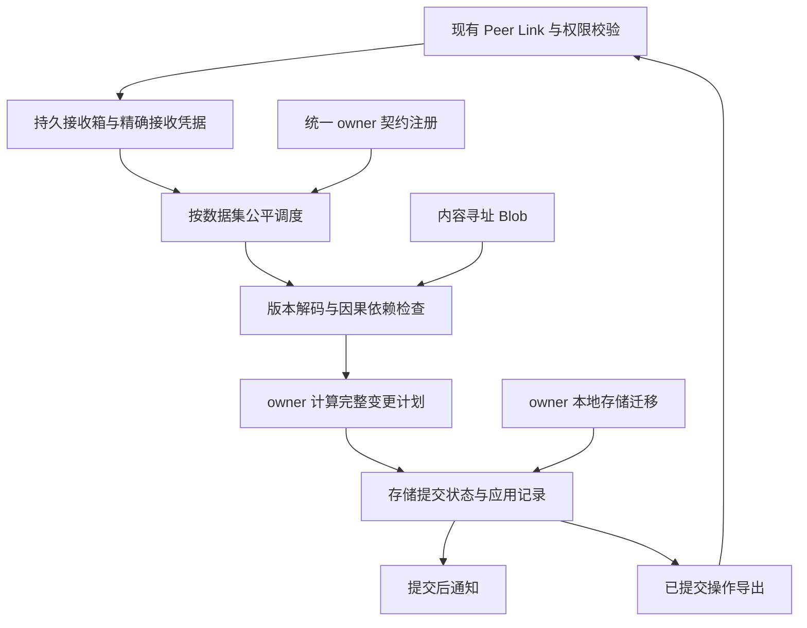

# 跨端同步问题审查与修复记录

审查日期：2026-10-21。修复记录更新：2026-10-22。

状态：已实现偏好事务提交、历史解释、独立数据集重放和传输请求边界修复。第 1 至 9 节保留原始审查与目标设计，其中“当前代码”和行号指审查基线 `b2162bae`；实际交付和验证范围见第 10 节。本文没有把目标设计中的完整复制内核、因果检查点或所有 SQL 并发规则重构算作已完成。

## 1. 问题的本质

当前同步系统把六种不同责任放进了同一条应用路径：

1. 原始操作的可靠传输与去重。
2. 本地存储 schema 升级。
3. 不同版本操作的解释。
4. 业务事务的冲突处理与原子提交。
5. 实体去重、别名生成、名称冲突和引用重写。
6. 旧版本业务数据的导入与退役。

这些责任的边界各不相同。当前实现却多次用一种边界代替另一种：

- 用本地 schema 版本推断远端事务已被覆盖。
- 用普通引用的无向连通分量充当事务与故障隔离边界。
- 用网络交换结束标志触发业务实体合并。
- 用日志已追加、应用元数据已更新代表业务文件已经提交。
- 用 domain 作为事务失败后的阻塞范围。

因此，这不是某个异常处理分支不足，而是复制、版本、事务和业务合并混在一起。继续增加例外会使代码更难证明正确。

本文能证明以下代码路径存在设计缺陷；不能据此断言三份日志中的每个失败都由同一个缺陷触发。日志里的实体 ID 失败记录和 Windows 拒绝访问的具体文件系统原因仍没有完整证据。

## 2. 必须先确定的正确性约束

### 2.1 三种版本严格区分

| 名称 | 责任 | 是否影响远端协议 |
| --- | --- | --- |
| 协议版本 protocolVersion | 操作信封、凭据和传输消息结构 | 是 |
| 同步契约版本 contractVersion | 某个 owner 的逻辑实体、字段和变更语义 | 是 |
| 本地存储版本 storageSchemaVersion | JSON 布局、SQLite 表结构、索引与缓存 | 本身不应影响 |

更新本地表结构或把编码字符串改成 JSON，不应自动产生一批业务修改，更不能自动覆盖另一设备尚未收到的业务事务。

确实改变共享业务含义的升级，要作为 owner 的同步契约演进处理。它需要明确的操作转换规则，不能仅迁移本地状态。

### 2.2 接收、应用和覆盖分别记录

- Received：经过信封校验的原始操作已可靠保存。
- Applied：owner 已完成解释，业务状态与该操作的应用结果已一起提交。
- CoveredByCheckpoint：指定检查点可以证明包含了这个操作的效果或其明确的冲突处理结果。

收到不等于应用成功。版本较新、内容相同、键已存在，也都不是 CoveredByCheckpoint 的证明。

重复投递使用相同原始身份和内容哈希验证。版本转换不能给原始事务重新分配身份，从而造成重复应用。

### 2.3 事务边界由业务明确声明

网络页不是事务，domain 不是事务，存在引用也不是事务。

首轮重构只支持一个数据集内部的原子事务。数据集是一个明确归属、具有共同提交边界的数据单元，例如一个偏好存储或一个插件数据库。内置 owner 和插件 owner 使用同一个注册与复制接口。

不同数据集之间存放稳定引用。跨数据集的业务流程不能宣称拥有单次原子提交。必须同时满足业务不变量的数据，应放进同一个事务数据集。

事务的本地原子性也不等于离线多节点全局串行化。同步契约必须明确并发冲突如何处理，不能把某条记录的时间比较结果当作事务整体的业务决定。

### 2.4 一处提交事实

业务状态、应用记录、原始操作的处理结果和本地待发送事务必须拥有同一处提交事实。

提交点之前的内容不能导出为已发生的业务事务；提交点之后的内容必须能在重启后完整读到或确定性恢复。

### 2.5 普通引用不产生反向阻塞

角色卡引用模型配置，不代表模型配置需要等待角色卡成功。

必须应用的前置条件应明确声明目标操作或目标数据版本。普通 ID 引用可以被保存，读取和执行时明确报告目标不可用。只有确实声明的应用前置条件才能阻塞相应事务。

## 3. 审查基线中的确定问题

### 3.1 用较高 schema 排除未被覆盖的旧事务：存在静默丢失变更的路径

位置：`PreferencesDataStore.rs::filterSyncedEntries`，约 2679 行。

当前先收集每个 `(storagePath, key)` 的最高 schema，然后排除键全部被更高 schema 覆盖的操作。这个条件没有证明高版本快照包含该操作。

可以直接从代码构造反例：

1. A 已有 counter=10，并完成本地 v1 到 v2 迁移，输出 v2 快照。
2. B 离线期间产生 v1 的 `counter += 2`，A 的迁移并没有看到它。
3. A 接收 B 的事务；B 不是 A 的来源，不会被 A 的来源迁移序号覆盖。
4. 按键收集出的最高 schema 是 v2，B 的 v1 操作被筛掉。
5. 外层仍把该组原始 incoming 操作记为已处理并清理 pending。

此路径不会得到应该保留的 +2，也不要求上报失败。它比“迁移失败报错”更危险。

处理决定：删除按键最高 schema 判定事务已被覆盖的规则。覆盖关系只认明确操作集合或可验证因果边界。

### 3.2 迁移快照的两套覆盖规则不一致

位置：

- `PreferencesDataStore.rs::filterSyncedEntries`。
- `SyncOperationStore.rs::preferenceKeysCoveredByNativeMigration`、`legacyPreferenceOperationSuperseded`，约 2029、2118 行。

一处以同来源、同文件的 migrationSnapshot 序号排除历史；另一处还会通过某个 native 操作是否覆盖旧键集合，推断未标记的历史迁移。版本、来源、键和时间分别被用作覆盖依据。

覆盖所有键并不能证明覆盖所有增量事务；本机已经升级也不能证明另一台离线设备的修改被包含。

处理决定：删除复制内核中的偏好迁移推断。已发布格式的读取和转换归入明确版本的 owner 导入器，原始历史保留，不能用推测决定丢弃事务。

### 3.3 本地迁移与同步协议绑定

位置：

- `PreferencesDataStore.rs::migrateSchemaUnlocked`、`persistUnlocked`、`recordSyncOperationsInternal`。
- `PreferenceSpaceMerge.rs::prepare`。
- `OperitApplication.rs::syncClock`，约 835 行。
- `character_cards/src/storage/preferences.ts::CharacterStorage.open`。

当前本地 schema 变化可以直接生成迁移快照操作；syncClock 会触发固定清单中 owner 的迁移；插件迁移却依赖插件打开自己的存储。接收物化使用没有注册 owner 迁移函数的存储实例。

这造成三个不同生命周期：固定内置 owner、插件打开时迁移、远端通用物化。不能由这些入口的调用先后来保证版本正确。

处理决定：删除 syncClock 触发业务迁移的职责。owner 注册并执行显式存储迁移生命周期；同步应用通过同一 owner 契约解释操作。纯存储升级不生成业务快照。

### 3.4 引用被变成无向事务分组

位置：`PreferenceMerge.rs::applyIndependentOperations`，约 217 行；建图约 279 行。

代码同时添加 `store -> reference.target` 和 `reference.target -> store`，对整个连通分量调用同一次物化。角色卡、模型、TTS、主题及其他插件偏好因此可以成为一个失败单元。

这解释了日志里大量文件同时报失败的结构原因，但不能定位最先失败的具体记录。把报错组全部归因于插件是不准确的。

处理决定：删除用引用连通分量决定提交范围的算法，而不是只把双向边改成单向边。事务、普通引用、应用前置条件必须各自有明确表示。

### 3.5 本地偏好日志可以先于业务提交变成已应用事实

位置：

- `PreferencesDataStore.rs::persistUnlocked`，约 3248 行。
- `SyncOperationStore.rs::appendLocalOperation`，约 464 行。
- `PreferencesDataStore.rs::loadUnlocked`，约 2901 行。

当前持久化顺序是记录同步操作，然后写业务文件。appendLocalOperation 已追加日志、推进时钟和应用元数据，并发布同步变更通知。普通加载路径主要读文件，没有为全部普通偏好写入提供统一的已提交事务恢复协议。

因此业务写入失败时，日志导出与本地状态可能描述不同事实。特定 replaceRecoverably 入口的恢复处理不能证明普通 edit 路径也具备相同保证。

处理决定：重写偏好提交协议。同步日志不能在事务提交前自行宣布操作已应用、可导出。

### 3.6 多文件先校验后写入不等于原子事务

位置：`PreferencesDataStore.rs::materializeSyncedSnapshots`，约 2797 行。

当前会锁多个存储、验证所有内存快照，然后逐文件提交。后一个文件失败时，前一个文件已经写入；应用元数据又在外层单独更新。

处理决定：删除把任意引用组一起写入就视为事务的假设。显式数据集内部必须有实际提交点；跨数据集不隐含原子性。

### 3.7 接收重放可以在业务提交前生成新的同步操作

位置：`PreferenceMerge.rs::applyDeclaredOperations`，约 379 行；别名记录约 528 行。

通用物化同时做历史重建、实体 ID 校验、内容去重、名称修改、跨文件引用重写，并在物化回调中追加新的 alias 操作。追加动作发生在各业务快照最终发布之前。

接收事务因此有新的全局副作用，其原子性不由原事务覆盖。重复重放、崩溃和部分写入都会使推理复杂化。

处理决定：移除通用接收器自动生成别名与业务写入的能力。保留稳定实体 ID；合并重复实体由 owner 的明确业务事务产生持久别名，普通引用通过目标 owner 的别名解析。

### 3.8 complete 把传输边界变成了业务合并许可

位置：

- `SpacePersistenceSyncService.rs::synchronizeDomains`、`applySynchronizedOperationBatch`、`preferenceHistoryComplete`。
- `PreferenceMerge.rs::mergeRecords`。

网络页为空且导出未报偏好域失败后，complete 被传到偏好合并，并影响实体内容去重。这里没有固定、带因果范围的共享检查点。收到所有操作也不代表所有操作已经成功应用。

处理决定：删除复制协议中的业务 complete 开关。分页结束只报告本轮传输结果；初始化合并与检查点使用明确状态边界。

### 3.9 事务含义在不同实现中不一致

位置：

- `PreferencesDataStore.rs::retainKeys`，约 2280 行。
- `PluginStorage.rs::applyOperation`，约 2677 行。
- `SqlChatSyncStore.rs::applyOperationInternal`，约 448 行。

偏好事务允许按键过滤掉子修改；插件数据库在一个 SQL 事务内对各记录分别比较时间并跳过冲突记录；聊天存储另有整项操作判定。它们都可能使用 Transaction 名称，但表达的冲突与原子性保证不同。

插件 SQL 的物理事务是有价值的。问题是不能把物理提交原子性、逐记录合并和业务事务整体有效性混称为一个保证。

处理决定：先写明共享 Transaction 契约，再让 owner 提供整体变更计划及校验。通用层不能静默删掉事务中的子操作。已有已发布事务的转换必须由明确版本导入器处理。

### 3.10 物理时间被当作重放与冲突顺序

位置：`SyncOperationStore.rs::SyncOperationOrder`，约 259 行；插件记录版本比较也使用 createdAt。

偏好重放将 createdAt 排在来源序号之前。相同设备的时钟向后调整，就可能把后写的操作排到前面。物理时间也不能证明跨设备因果关系。

处理决定：createdAt 仅用于展示与诊断。新协议显式携带逻辑时钟与因果依赖。数据集内同一写入来源的顺序由来源序号保证，并发排序使用契约规定的稳定规则。

### 3.11 domain 级失败阻塞与业务特例渗入复制层

位置：`OperitApplication.rs::syncApplyOperations`，约 1006 行；`blocked.insert((originDeviceId, domain))` 约 1137 行。

复制入口知道 retired character 数据、偏好分组、SQL 插件依赖、引用协调和聊天刷新。非偏好事务失败后用来源加 domain 阻止后续操作。已有数据库来源编码提供了一部分隔离，但隔离仍取决于各实现怎样拼 origin，而不是统一、可验证的数据集定义。

处理决定：把失败状态和调度范围改成数据集与明确依赖。角色历史退役与导入归还角色 owner；应用入口只组装复制服务与提交后订阅。

## 4. 推荐方案

推荐一个共享复制内核，按数据集组织，owner 定义版本化逻辑契约，存储负责同一事务提交。保留现有 Link、Host、JSON 偏好、SQLite 和 Blob 能力。

不引入第二套插件复制协议，也不要求把全部偏好搬进数据库。内置数据和插件数据使用同一复制接口，物化器接入现有存储实现。

### 4.1 数据集与 owner

数据集身份由 Space 范围、owner 和稳定数据集键构成，不以当前物理文件名作为唯一协议身份。

示例：core 的 model-configurations、tts-configurations；角色插件的 cards；某个插件独立的 memory 数据库。实际划分必须与真实原子提交边界一致。

注册内容包括：

- 数据集归属及被授权的存储路径映射。
- 可读写的逻辑契约版本。
- 本地存储 schema 及迁移函数。
- 不同操作契约版本的显式解码与转换。
- 稳定实体身份、变更语义、并发规则和事务验证。
- 所需 Blob 与确实必须满足的应用依赖。

远端数据不能自行成为可信的本地迁移实现。插件处理器来自本机已安装并受信任的包。owner 未就绪只暂停这个数据集的物化，原始操作仍可靠保存。

### 4.2 操作信封

建议下一版协议明确包含以下字段；名称和序列化方式在实现前冻结：

| 字段 | 含义 |
| --- | --- |
| protocolVersion | 信封协议版本 |
| spaceScope | 所属 Space 及其确定的成员范围 |
| datasetId / ownerId | 数据集与权限归属 |
| originIncarnation / sequence | 该数据集写入来源的唯一事务身份 |
| contractVersion | 此事务采用的逻辑同步契约 |
| causalDependencies | 事务依赖的已知操作边界 |
| logicalTime | 尊重因果关系的逻辑时间 |
| mutations | 同一业务事务的完整逻辑变更集合 |
| requiredBlobs | 内容哈希与尺寸 |
| contentHash | 对不可变原始信封进行内容校验 |

本地 storageSchemaVersion 不放在远端覆盖判定中。createdAt 不参与因果证明。

来源序号属于明确数据集流。不能要求某个数据集等待节点全局序号中属于其他数据集的空缺。恢复、导入与新身份建立还必须避免复用已有 originIncarnation。

### 4.3 全设备升级与原有数据

兼容目标是所有设备升级到当前版本后，原有持久化数据、历史操作和待同步事务仍然可用。不要求新旧设备同时在线，不实现协议协商、自动降级或双套写入路径。

本地迁移只转换存储表示；现有历史按 owner 声明的旧编码读取，保留原始操作身份。旧文件中没有根赋值历史的初始值只导入一次，复用现有 set/transaction 契约，不能用 schema 版本推断历史覆盖。已经记录的整数增量从当前值中扣除后得到初值，避免重放时丢失基数或重复计数。

### 4.4 事务执行与并发

远端事务经历完整的解码、依赖验证、计划计算、业务验证和提交。物化器计划阶段不追加新操作、不发送网络请求、不修改其他数据集。

每个数据集声明确定的并发规则。相同的初始状态、操作集合与契约版本必须产生相同投影与事务处理结果。

有顺序语义的操作不能靠简单的最后写入值比较处理。迟到的因果前置操作需要参与该数据集的重物化；历史在具有稳定性证明前保留。检查点不自动赋予删除历史的权限。

事务内部业务校验失败，返回明确的整个事务结果。契约允许的并发冲突合并规则必须作为完整计划的一部分实现和测试，不能靠通用接收器临时跳过某几条修改。

### 4.5 提交协议

SQL owner：业务修改、应用操作身份、处理结果及本地 outbox 写入同一个现有 SQLite 事务。聊天存储把业务和日志放在同一事务的做法可以保留并提取成契约。

JSON owner：一个文件承载一个提交封装，封装内同时保存业务 values、storageSchemaVersion、来源序号、应用记录、处理结果及未归档 outbox。通过 Host 的 writeBytesAtomically 一次发布完整封装。所有这些字段与业务状态共享同一个提交点，保留现有按完整 JSON 文件写入的基本存储方式。

已提交 outbox 可以异步归档到共享不可变操作库。只有操作库可靠保存并验证原始身份及内容后，才能在后续原子文件提交中删除该 outbox 项。中断后的重复归档按原始身份幂等处理；尚未提交的事务不存在可导出的 outbox。

应用记录以 owner 的提交封装或 SQL 事务内记录为准，公共应用索引是可重建的派生索引。接收原始内容及其哈希仍由持久接收箱保留，不能只留下序号凭据后失去内容一致性校验。

业务 API 不暴露内部元数据。备份、导出、观察者、缓存和历史文件读取通过明确版本的存储入口处理新封装，不能把封装当作普通业务键值映射。

原子文件发布的 flush、替换和重启一致性属于 Host 能力契约，必须在现有 Host 实现中验证。不能仅凭函数名字认定具备断电持久性。

此方案保留 JSON 业务存储，不构建任意多文件代次管理系统，也不用一个外围状态文件假装数据库事务。首轮不提供任意跨 JSON 文件和 SQLite 数据库的通用分布式事务。

### 4.6 检查点

检查点是 owner 的逻辑状态及明确历史覆盖证明，必须包含数据集、契约版本、精确覆盖范围、内容哈希，以及状态所需的删除和别名信息。

它是导入、重物化和安全压缩的显式协议对象，不是普通的 set 操作，也不是本地迁移快照。

收到一个较新检查点，不代表可以丢掉覆盖范围之外的离线事务。多来源检查点合并、迟到操作与日志回收必须满足该数据集声明的规则。第一阶段不做没有稳定性证明的历史回收。

### 4.7 引用、别名和实体去重

稳定实体 ID 不因别的实体内容暂时相同而在通用接收过程中自动改变。

需要合并重复角色、主题或配置时，owner 执行明确的 MergeEntities 业务事务，保存可重放的别名决定。首次加入时的合并是有明确输入边界的业务步骤，使用同一事务机制。

引用保存目标 owner 与稳定实体 ID。别名由目标 owner 解析，不能要求收到别名时立刻改写所有引用者文件。

引用关系和应用前置条件分别建模。删除目标后引用的表现由业务契约决定，不能依靠将两个数据集绑定为共同失败单元来处理。

### 4.8 数据集级调度和结果

复制传输负责分页、字节预算、连接和原始操作持久化；数据集调度负责物化。慢 owner 不应持有全局应用锁等待插件执行或全量历史重放。

结果使用结构化状态，例如 Ready、WaitingOwner、WaitingContract、WaitingDependency、WaitingBlob、InvalidTransaction、StorageError。错误记录附带 datasetId、事务身份与阶段，不通过错误字符串推断类型。

Blob 缺失只暂停依赖该 Blob 的事务。网络连接正常、收到操作、本地物化完成和全量追平要分别表达。

## 5. 保留、删除和重写清单

| 位置 | 决定 | 替代责任 |
| --- | --- | --- |
| Peer Link、成员权限、Host 能力层 | 保留 | 现有连接、安全与平台能力 |
| 精确区间接收凭据、原始操作身份冲突检查 | 保留并调整数据集范围 | 共享复制内核 |
| 内容寻址 Blob、分块与哈希校验 | 保留 | 数据集事务的明确内容依赖 |
| 传输页字节预算与请求编号修复 | 保留 | 纯传输逻辑 |
| PreferencesDataStore 类型化 API、schema 逐版本迁移函数 | 保留，拆开职责 | owner 本地存储与 API |
| PreferencesDataStore::filterSyncedEntries 的版本覆盖推断 | 删除 | 显式契约解码、因果覆盖证明 |
| SyncOperationStore 的偏好专用迁移推断与特例压缩 | 删除 | owner 导入器、明确检查点 |
| PreferenceMerge::applyIndependentOperations 无向分组 | 删除 | 明确数据集、事务与单向应用依赖 |
| PreferenceMerge::applyDeclaredOperations 的全局重放、去重、别名副作用 | 拆除并重写 | owner reducer 与明确业务合并事务 |
| 当前跨文件 materializeSyncedSnapshots 提交方式 | 重写 | 明确存储提交点 |
| persistUnlocked 先发布日志后写业务文件 | 重写 | 状态、应用记录与 outbox 同一提交事实 |
| syncClock 中迁移、扫描业务工作 | 移出 | owner 生命周期、独立工作区扫描 |
| OperitApplication 中偏好/角色/插件专门应用流程 | 移出 | 注册 owner 与提交后订阅 |
| source + domain 级事务阻塞 | 删除 | 数据集流及明确事务依赖 |
| complete 驱动偏好去重 | 删除 | 固定边界的 owner 合并事务与检查点 |
| PluginStorage 与 SQL chat 的实际 SQL 事务 | 保留 | 同一事务提交业务和复制元数据 |
| PluginStorage 独立的通用复制调度与跨偏好引用协调 | 合并/移出 | 共享内核与目标 owner 别名解析 |
| plugins 的配置/记忆转换函数与已发布格式读取 | 保留，归属明确 | 可信 owner 契约与导入器 |
| isRetiredCharacterOperation 等通用入口业务特例 | 移出 | 角色 owner 明确版本导入 |

目标不是把所有实现重新塞进一个巨型 SyncManager。共享层只定义身份、接收、因果依赖、调度、提交契约和导出；业务结构留在 owner，存储实现在既有 Host 之上。

## 6. 为什么选这个方案

继续在现有 PreferenceMerge 中增加 schema 分支，无法消除覆盖推断和事务提交的双重事实。

仅把无向图改成有向图，无法解决旧事务被筛掉、业务文件写入失败却已发出操作的问题。

要求所有设备同步升级，不能处理升级前已经产生且未传输的离线事务。

全部数据搬进 SQLite 能提供本地事务工具，但仍要解决逻辑契约、因果覆盖和跨 owner 隔离；它也扩大了本次数据迁移范围。

引入完整 CRDT 引擎会改变现有存储和业务语义，仍需要 owner 的版本转换与事务验证。当前没有证据表明必须进行这种范围的替换。

因此，推荐保留已有效的连接与存储能力，重建复制协议的责任边界。最先验证的是不会丢事务、不会提前宣布提交、不会沿普通引用扩散失败，而不是新代码行数。

## 7. 实施顺序及完成条件

### 阶段一：固定语义与失败反例

冻结数据集、事务、版本、接收、应用、检查点和并发规则的定义。新增反例测试，替换把无向连通分量整体阻塞当作正确行为的测试。

本阶段不增加通用同步例外。

### 阶段二：建立可证明的提交路径

先选一个 JSON 偏好数据集和一个 SQLite 数据集，完成同一提交事实与故障注入测试。原始操作持久接收与数据集应用分开。

完成条件：任意注入点中断后，业务状态、应用身份和可导出事务都对应同一个已提交结果；重复投递不会重复应用增量。

### 阶段三：统一 owner 契约与数据集调度

内置配置和插件使用相同注册机制。新复制内核不依赖 character_cards 名称，不在 syncClock 运行迁移。

完成条件：一个插件无处理器、无 Blob、版本不支持或写入失败，不阻止普通配置、聊天和其他数据集推进。

### 阶段四：版本化导入既有数据

为已发布原始操作、迁移快照、别名和已应用元数据编写明确版本导入器。

重要限制：旧日志没有保存充分覆盖信息时，不能事后凭空证明某个快照包含了哪些远端事务。导入器必须标明可证实范围和歧义。歧义属于数据集修复问题，需要具体证据，不能静默清理原始历史或标记已应用。

导入和切换按原子提交完成。新协议通过版本协商明确切换，不运行两套应用器同时修改同一数据集。

### 阶段五：删除旧路径，做真实双端验收

移除旧的全局 PreferenceMerge 调度、迁移推断、complete 语义和通用业务特例。保留明确格式的只读导入能力，不保留旧写入引擎。

验收覆盖双端不同版本、离线修改、重启、恢复、成员变化和权限变化。

## 8. 必须通过的测试

1. A 已迁移，B 的旧契约离线增量晚到：不会因 schema 较低被静默完成。
2. A/B 使用不同本地 storageSchemaVersion、相同 contractVersion：事务可正确交换。
3. 旧契约事务经显式转换后保留原始身份，重复传输只产生一次效果。
4. 协议不支持某插件契约：该数据集等待，模型/TTS/聊天继续应用。
5. 插件字段、插件 schema 或插件 Blob 出错：普通配置不进入同一失败事务。
6. 多键事务某一步校验失败：没有子修改被静默应用或静默过滤。
7. 本地提交在写日志、写状态、发布提交点前后分别中断：重启后结果可判定且一致。
8. SQL 的业务修改、应用记录、outbox 在同一事务边界接受故障注入。
9. JSON 状态、应用记录与 outbox 以同一文件封装提交；未提交内容不被读取或导出；中断归档后不会丢操作或重复应用。
10. 原始身份相同、内容不同的操作：明确拒绝，不能只按凭据跳过。
11. 同源操作、跨源因果操作、并发操作，以不同网络顺序、分页边界和重复次数输入：同一有效操作集合得到一致投影。
12. 设备时间向后调整：不改变来源操作顺序与因果关系。
13. 旧事务不在检查点 covered 范围中：仍进入处理，不能被新版本或快照时间覆盖。
14. 检查点包含删除与别名，重启、重新加入及迟到操作不会复活已删除实体。
15. 角色合并是明确事务，重复重放接收历史不会产生新的别名事务。
16. owner 升级、插件未启用、插件稍后就绪：原始队列和应用进度分别正确。
17. 原有工作区文件同步边界、成员权限和 Host 能力行为保持可验证。

这些是原始目标设计的验收矩阵，不代表本次全部实现或通过；本次已运行的检查单独记录于第 10 节。

## 9. 参考依据与本次产物范围

代码事实以本文列出的仓库函数为依据。外部资料只用于核对设计原则：

- Leslie Lamport，Time, Clocks, and the Ordering of Events in a Distributed System：因果关系与逻辑时钟。
- SQLite 官方文档 Atomic Commit In SQLite、SQLite Is Transactional：提交点、故障恢复与事务原子性。
- Ink & Switch，Project Cambria: Translate your data with lenses：本地数据迁移与多版本分布式操作兼容是不同问题，变更本身也需要明确转换。

本方案不要求引入 Cambria 或其他新库。Host 原子发布的实现与契约需要单独验证，不能从外部资料直接推断本仓库实现正确。

原始审查阶段只产出设计文档；后续已按用户授权实施下述修复。

## 10. 本次实际实现与验证

### 10.1 删除和替换的行为

- 删除按最高本地 schema 过滤旧偏好操作、按键集合推断迁移已覆盖历史的规则；偏好原始历史完整保留。
- 本地 schema 升级只更新本地表示；不再生成替代业务历史的同步快照。已发布编码由模型、TTS、STT、主题、API、绑定、工作区及扩展设置等各自 owner 的明确历史转换器解释，不检查字符串内容来猜格式。同步时先转换本地完整文件，再提升 schema；本地已经提交的当前契约值不再次按旧编码解释。
- 每个偏好文件独立解码、验证和提交；普通稳定引用不再组成无向失败分组。跨文件应用明确不具备单次原子性。
- 删除通用接收器按内容自动合并实体并生成别名的路径；只重放已明确记录的身份决定。引用投影只使用目标数据集已经提交的决定。
- 删除传输 `complete` 参数及对应的远端请求校验字段；分页和分块只影响传输，不能决定业务身份合并。
- 同来源操作按来源序号重放，新偏好契约显式携带 `contractVersion: 1` 与逻辑时间；本地存储版本不再充当新操作的协议版本。
- SQL 插件先在自身事务中检查是否已经应用相同原始操作。删除因普通偏好引用目标未就绪而拒绝事务的规则，删除 `PreferenceMergeContext` 及其失败状态传播。应用调度的有序失败阻塞细化到来源、domain 和数据集。
- 删除按内容复用本地操作的两个未使用入口：`appendLocalStateIfChanged` 和 `appendLocalPreferencesTransactionIfChanged`。
- 删除运行时重复维护的五个 owner 构造列表。准备阶段使用共享 schema，通过同一迁移、导入和重放入口处理现有文件，并发现尚未打开的扩展设置；不创建缺失的 owner 文件。
- 补齐 Space 成员、设备资料、在线记录和拓扑记录的 owner 解码声明。旧历史中 `record` 的 JSON 字符串只由 Space owner 解码；存储版本升至 3，修复先前已被原始历史覆盖坏的版本 2 快照。普通自定义字符串保持原类型，不按内容猜测 JSON。
- 加密偏好历史先按 owner 路径筛选再解密。一个数据集的旧错误密钥历史不再阻止另一个无关数据集，属于当前 owner 的解密失败仍明确报错。
- 修复旧角色导入允许空选择 ID 的漏检。Git 定位到 `b968cf12`（2026-10-21）：移除目标存在性校验后，类型检查仍允许空字符串。保留非空但已删除的角色选择，拒绝空 ID；合并角色卡和角色组校验分支。

### 10.2 明确的提交事实

偏好文件的内部保留字段 `__operit_preferences_replication` 与业务值一起通过现有 Host 原子写入接口提交。该字段包含一次性初始值导入标记、来源 epoch、来源序号、逻辑时间、已应用原始操作指纹及待归档 outbox；对外业务序列化不暴露该字段。

业务文件提交之后才把 outbox 中的原始操作归档到公共同步日志。原始日志 flush 成功后才清除 outbox。原生 Host 刷新文件，在 Unix 上同时刷新所在目录；其他 Host 默认使用原子重写回退。归档失败保留同一原始操作，重启后仍能继续发布；业务文件写入失败不会产生可导出的幽灵操作。`runtime/sync/preference_outboxes.json` 只登记数据集位置和加密策略，登记成功不能代表业务事务已经提交。

数据集锁覆盖历史收集、归档历史与持久 outbox 合并、解码重放和业务提交。即使调用方历史快照较早，或日志发布失败，也不会漏掉该文件已经提交的本地事务。读取归档的内部接口不再次发布 outbox，避免在数据集锁内递归获取同一个锁。

追加失败会使日志缓存失效，重试会隔开残缺尾行，避免完整操作与半条 JSON 拼接。原始接收凭据与待应用队列独立保存；应用完成后仍保留操作内容指纹，同一身份携带不同内容会明确报错。来源序号冲突不会通过队列插入静默覆盖。

### 10.3 已运行的行为检查

- `operit-store` 单元测试：209 通过，2 忽略。
- `plugin_preferences` 真实文件存储集成测试：14 通过。
- `plugin_storage` SQLite 集成测试：40 通过，1 忽略。
- `preferences_upgrade` 真实存储回归测试：8 通过，覆盖未记录初始值、三设备乱序与重复投递、仅增量旧日志、完整文件迁移、迁移失败回滚以及旧编码和当前契约混合。
- `sync_operation_store` 分页集成测试：1 通过。
- `operit-runtime` 单元测试串行运行：296 通过，包含 owner 契约、Space 历史修复和准备阶段测试，以及 67 项旧角色迁移测试。旧角色导入的原有失败已经修复，两种旧来源均覆盖空 ID 拒绝和已删除角色选择保留。
- `SpacePersistenceSyncService` 分页和 domain 隔离测试：8 通过。
- 实际路由同步门控测试 `sync_idle_gate`：4 通过，覆盖空闲探测、失败重试、本地偏好变化和插件失败期间的健康复制推进。

关键反例包含写业务文件失败、日志归档失败、归档确认失败、重启、重复投递、倒序分页、时钟回拨、旧历史快照、目标别名提交失败，以及插件数据集验证失败。双端计数回归中初值为 10，离线分别增加 2 和 3，重复及倒序投递后双方均为 15。另一个回归让两个节点先各自产生未传输操作，随后同时将本地存储 schema 从 1 升至 42；迁移不发布操作，升级后再分别增加 4 和 5。倒序、重复投递给两个原节点及第三个空节点，三者均为 24，保留全部原始操作；新业务操作携带稳定的 `contractVersion=1`，不携带本地 `schemaVersion`。

最新检查另含 `node-state` 功能下的 22 项 Space 测试，以及正常运行时的启动会话集成测试。完整测试日志在 `/tmp/operit-space-repair-full-tests.log`，版本升级最终复核在 `/tmp/operit-accept-final-upgrade-tests.log`。

### 10.4 范围和未证明事项

- 本次未发布安装包；已使用当前分支编译运行用户的 macOS 应用与 iPhone 18 Pro 模拟器，并执行第 10.5 节的真实运行验收。没有覆盖实体 iPhone 或 Windows 系统环境。
- 日志中的 Windows Blob `Access denied (os error 5)` 尚缺少能够定位实际拒绝访问原因的证据，不能宣称本次解决了系统权限问题。
- 没有引入完整共享复制内核、通用因果检查点或重写全部 SQL 业务冲突策略。偏好原始历史的长期压缩需要有覆盖证明的单独协议。
- 已发布的历史迁移快照按其原始明确操作读取；缺失的历史覆盖信息不能事后推断。已经被旧代码丢弃且不再存在于任何设备中的操作无法凭空恢复。
- 新远端操作请求只携带 `operations`。所有设备应升级到配套版本，保留的旧编码读取仅服务持久化数据升级。

### 10.5 本机 Mac 与 iOS 模拟器验收（2026-10-22）

环境：同一分支的 macOS 应用与 iPhone 18 Pro 模拟器，Core 版本均为 `2.0.0-preview.17`。通过 Flutter VM 调用应用现有的生成代理，再经过真实 Native Core 和 Peer Link；没有用直接复制业务文件代替同步。未调用付费模型接口。检查脚本保存在 `/tmp/operit-accept-*`，不向产品加入测试接口。

- 正常 Flutter iOS 构建用时 122.7 秒，运行时启动约 650 ms；冷启动约 879 ms。macOS 冷启动运行时约 374 ms。两端均能读取 2 个模型配置、原有语音配置与会话列表。误用另一项 XCTest 的未签名应用曾造成 Keychain entitlement 错误；改回正常 Flutter 签名构建后消失，没有修改 Keychain 实现或清空数据。
- 原有配对指向已失效的旧局域网地址。通过现有配对和验证码确认 API 重建连接，保留原 Space 成员与业务数据。重启后能自动连接。
- Mac 新建普通对象、外观为 JSON 的字符串、加密 HTTP TTS 配置和 SQL 会话；iOS 收到后修改，Mac 收到同样结果。检查了嵌套值、字符串类型、合成测试密钥完整性、会话标题和计数。初次双端增量为 2/20 与 3/30，两端合并为 5/50。
- 停止两端传输与同步，在离线状态分别提交 4/40 与 5/50，再启动原监听与同步，两端均为 14/140。Mac 与 iOS 分别冷启动后仍通过完整数据检查。
- iOS 删除临时 SQL 会话和自身测试键，Mac 收到删除；Mac 删除临时加密 TTS、普通测试键和测试计数，iOS 收到删除。两端测试业务记录均已清理，保留必要删除历史。
- 两端 `syncClock` 最终均为 `pending=0`、`errors=[]`、`pendingBlobs=[]`，两个成员均在线。原 Space 记录的 `record` 均为对象，不再是编码字符串。

真实旧数据另做了有备份的显式恢复，未放宽生产校验：

1. macOS 的旧日志有两个重用操作身份、内容不同的记录。仅将后出现且被同来源、同实体后续完整状态明确覆盖的两行移到恢复归档，原始全文、哈希和覆盖证据保留。iOS 日志无该冲突。
2. 恢复备份遗留的 `export_floors.json` 排除了 72 条消息的全部原历史，因此 iOS 虽然同步空闲，仍缺少这些消息。保留原导出边界，关闭 Mac 应用后调用现有 `SqlChatSyncStore::recordMessageSnapshot` 为当前消息发布新的完整记录，再让真实连接传输。另对正文已存在但作者命名空间不一致的 34 条消息补发当前完整记录。操作前先在副本验证；业务表不变，全部原始 SQL 操作保留。
3. 全量备份位于 `~/Library/Application Support/Operit2-backups/sync-acceptance-20261022-025342`，SHA-256 已核对；历史日志修复与两次消息补发各有独立恢复归档和报告。没有导出平台密钥。

最终清理后两端均为 **35 条会话、148 条消息、387 条消息片段、0 条额外消息变体**。按全部业务列比较（排除本地自增行号，对 JSON 命名空间做解析比较），四张表均一致，SHA-256 一致。SQLite 完整性及外键检查均通过。两端的 2 个模型配置和 1 个语音配置读取正常，配置内容的规范化指纹一致。

验收证据包括 `/tmp/operit-acceptance-*-roundtrip.log`、`/tmp/operit-acceptance-*-offline.log`、`/tmp/operit-acceptance-*-cold-restart.log`、`/tmp/operit-acceptance-*-clean.log`、`/tmp/operit-acceptance-*-health.log`。SQL 全表最终比对记录见 `/tmp/operit-acceptance-final-business.json`；消息自增行号属于本地索引，JSON 命名空间按解析后的值比较。验收不要求历史导出边界以内的日志条数相同，但要求当前业务数据相同且同步队列无错误。上述证据另归档到全量备份目录内的 `acceptance-evidence`，附文件哈希清单。
