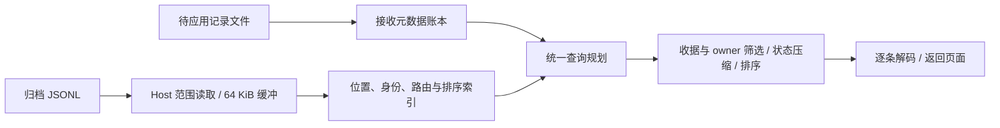

# 同步日志读取与接收队列的内存边界

## 问题与证据

Build 26 的 TestFlight 报告在 `serde_json::Value` 对象构建期间进入 `rust_oom`，失败的分配为 632 字节。报告能证明进程已无法完成普通的小额分配；它不能单独确定正在解码的 JSON 文件，也不能把同步日志断言为用户这次崩溃的唯一原因。

源代码和本地分配器测量确认了同步存储中的独立缺陷：分页之前会把完整日志展开成 `Value`，按 domain 查询还会常驻完整 payload。全局强引用注册表使最后一个调用者离开后缓存仍然存活。接收状态把待应用 payload 内嵌在 JSON 中，导出入口在分页后追加全部待应用记录，又绕开了分页内存边界。

## 统一读取链路

- `SyncOperationJournal` 负责范围读取、行偏移和轻量索引。索引不持有业务 `Value`；扫描逐条检查 JSON 数字和结构合法性，并提取路由与逻辑时间。
- `SyncOperationStore::readJournal` 是导出、合并声明查询和 owner 历史查询的共同入口。收据、domain、数据集、导出水位先筛选；调用者的额外过滤在实体状态压缩之前执行。偏好历史和事务不进行实体状态压缩。
- 加密记录或依赖 payload 的过滤会逐条解码并丢弃临时树。最终页面按精确序列化字节数和记录数停止。首条超限记录仍按原有协议返回，由传输层报告。
- 待应用与归档原始记录在同一规划器中去重、压缩、排序和分页。应用层不再在分页后追加完整队列。
- `preferenceMergeHistory` 只返回声明和身份决策；owner 的历史查询只解码该数据集。偏好初始化复用已经读入的历史，不重复拉取。
- 全局注册表只持有 Host 和共享状态的弱引用。重叠的 Store 实例共享锁；最后一个所有者释放后，索引、账本和 Host 可以释放。
- 锁顺序统一为接收账本在前、按设备顺序的日志锁在后。规划和读取期间保留日志锁，防止修复操作使记录偏移失效。

删除的旧实现包括 `domainOperations`、`readOperationLog`、`readOperationLogRange`、`decodeOperationLog`、`operationsSinceWithExportPolicy` 和 `archivedOperationsSinceWithExportPolicy`。诊断与隔离修复使用相同的范围行读取器，不再读取完整输入文件；隔离修复的输出仍受 Host 整体写入接口约束。

## 接收状态的持久化与升级

新的 `receive_state.json` 为 `formatVersion: 2`，保存收据、指纹以及待应用记录的轻量元数据。payload 保存在 `pending/<sha256(opId)>.json`；加密偏好继续使用原有加密编码。

接收先原子发布记录文件，再提交包含引用和收据的账本。完成应用先提交删除引用的账本，再删除记录文件。提交失败不会让收据领先于已持久化数据，也不会提前删除可重试内容。加载时清理该私有目录中未被引用的记录文件。

旧的内嵌格式通过 `DeserializeSeed` 一条一条迁出，保留原始编码。所有记录文件落盘后才原子替换账本。迁移中断或账本提交失败，旧文件保持可读且可重新迁移。旧格式仅存在于这个单向升级入口。

## 验证与实测

同一个 macOS debug 分配器探针、16,384 条操作、每条含 128 个数字字段，日志 34,476,664 字节（32.88 MiB）：

| 查询 | 改造前 Rust 堆峰值 | 改造后 Rust 堆峰值 |
| --- | ---: | ---: |
| 仅导出 1 条，预算 32 KiB | 469.96 MiB | 9.54 MiB |
| 查询合并声明，结果 0 条 | 266.90 MiB | 7.43 MiB |

查询后的保留堆从约 234 MiB 降至约 6.38 MiB 的轻量索引；释放最后一个 Store 后，探针相对基线的保留分配为 843 字节。这是 Rust 分配量增量，不能当作 iOS RSS 或真机可用内存。

回归覆盖旧格式迁移和提交失败重试、接收与完成的原子顺序、加密落盘、稀疏收据、逻辑时间、过滤先于压缩、损坏行与隔离修复、Host 范围读取和共享状态释放。独立内存测试使用 >8 MiB 历史日志以及 512 条旧内嵌待应用记录，约束小页面和元数据查询的实际分配峰值，而不仅检查返回数量。

本次验证结果：

- `operit-store`：312 项通过，3 项既有测试忽略；包括独立分配器内存回归。
- `operit-runtime` 偏好合并：6 项通过；macOS 测试二进制显式链接 Accelerate 后运行。
- `operit-store --no-default-features --features node-state`：编译检查通过。
- iOS 27 / iPhone 18 Pro 模拟器：实际发送集成测试通过，包含 8 次完整发送、角色配置、世界书钩子和 SQLite 持久化。
- 同一模拟器：`sync_journal_recovery_test.dart` 通过，使用真实桥接和 Host 冷读 4,096 条归档、迁移 16 条旧队列记录，并校验归档与待应用记录的分页结果。
- 普通 `lib/main.dart` 启动后，同一进程持续运行超过 100 秒，未退出；截图为首次配置欢迎页，后台运行时尚未启用。实际运行时行为由上述两项原生集成测试覆盖。以上均为模拟器验证，不是真机结果。

## 边界

这次改造消除了隐藏的全历史 payload 缓存和导出时的整队列追加。轻量索引仍随记录数增长；单条超大记录、显式完整历史请求、完整待应用回放，以及一个数据集的合并工作集仍可能较大。现有偏好回放具有跨操作依赖，不能为节省内存直接拆成任意大小的页，否则会改变合并语义。

用户这一次 OOM 的具体输入尚未确定。需要用后续真机报告验证实际崩溃是否消失；本地内存回归证明的是上述已确认的放大和生命周期缺陷已被移除。
