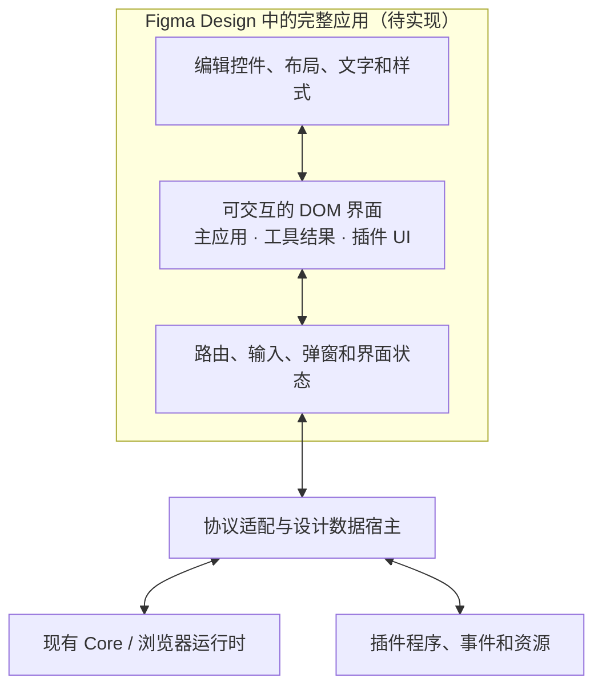

# Figma 内完整可交互、可编辑的 Operit

状态：需求与架构边界已确认；完整应用实现和真实 Figma 验收尚未完成。
核查日期：2026-10-30。

## 交付目标

设计同学打开一个 Figma 文件，在里面能使用整套软件：进入页面、返回、展开工具结果、打开弹窗、输入内容，以及进入插件自己的页面和子页面。到达任意界面后，可以修改其中的控件、文字、布局和视觉样式，再继续交互并看到修改。

设计对象是整个软件的 UI 和交互状态。单独的主题编辑器、页面截图、静态图层集合、仅有热点跳转的几个示例，都不满足这个目标。

## 当前代码实际提供了什么

| 入口                          | 已有能力                            | 与目标的差距                                           |
| ----------------------------- | ----------------------------------- | ------------------------------------------------------ |
| `src/plugin.ts`               | 导入 Figma 原生图层、导出修改及来源 | 没有运行 Operit 的路由、状态和事件                     |
| `capture.mjs`、`software.mjs` | 单场景或批量静态界面导出            | 场景之间没有真实行为；覆盖候选清单不代表全部界面可运行 |
| `src/theme_scene.ts`          | 主题组件示例                        | 不代表软件完整 UI                                      |
| `../../apps/flutter/app/web/` | Flutter Web 启动入口及浏览器宿主    | 不能据此认定 Figma 已能运行、选中并编辑每个控件        |

现有插件包只应被描述为静态辅助工具。模拟 Figma API 的测试可以验证文件和节点操作，不能证明完整软件在 Figma 内可用。

## 实时实现进展（尚未通过整软件验收）

`OperitDesignRuntime` 已接入真实 Flutter 输入与受支持的渲染属性修改；WebView 表面可把请求交给实际插件 DOM。`live.mjs` 通过 VM Service 连接运行端，`src/live_client.ts` 和 `src/live_main.ts` 提供持续更新的 DOM 客户端及受支持属性编辑，`build-live.mjs` 生成候选 Code layer Web 项目。启动方式和验证边界见 [LIVE.md](LIVE.md)。

客户端仍依赖本机运行的原生应用，尚不能作为自包含的整个软件交付。真实 Figma 内的交互与原生编辑、全入口覆盖，以及设计修改回到原始源文件仍待完成。下文描述的是完整交付要求，不能据此把已存在的实时客户端描述成完整实现。

## 已确认的运行基础

应用并非只有原生入口：

- `../../apps/flutter/app/web/index.html` 先加载浏览器数据维护入口，再加载 `operit_runtime_bridge.js`，同时启动 Flutter。
- `../../apps/flutter/app/web/flutter_bootstrap.js` 启动 Flutter Web 引擎。
- `../../apps/flutter/app/lib/core/bridge/PlatformCoreProxyWeb.dart` 选择 `WebWasmCoreProxy`。
- `../../apps/flutter/app/lib/core/bridge/WebWasmCoreProxy.dart` 通过浏览器中的运行时 API 派发调用、控制消息和流式订阅。
- `../../apps/flutter/app/web/runtime/src/operit_runtime_bridge.ts` 提供浏览器宿主、Worker、存储和其他能力。

因此，下一步应评估复用现有运行时和协议，而不是为设计文件逐页伪造所有业务行为。不过，新的界面实现仍需适配调用和订阅协议，不能直接假定已有 Flutter 页面可以转换为 DOM 页面。

## Figma 容器与编辑边界

Figma 官方文档说明，Code layers 可以在 Design 画布中运行 Web 前端项目，支持播放交互、Point and edit、提取原生设计图层以及向代码层推送修改。该功能正在以 open beta 逐步开放。它支持 Web 应用，不能直接运行原生移动或桌面项目。

这使 Code layer 成为候选运行容器，而不是普通文件导入插件。不过，这不证明当前 Operit Flutter Web 已兼容它。

本仓库锁定的 Flutter 工具链在 `packages/flutter_tools/lib/src/web/compile.dart` 中使用 CanvasKit / skwasm Web 渲染模式。现有 Flutter 控件不是可直接修改 CSS 的 DOM 控件。因此，**将 Flutter Web 构建产物放进容器，即使能够运行，也不能据此承诺设计同学能逐个选中、调整并回写所有控件**。这一点是根据当前渲染架构作出的工程判断，需要实际验证。

还必须验证资产体积、WASM 和 Worker 加载、浏览器存储及子页面在容器中的能力。现有 Web 宿主的本地语音路径要求跨源隔离响应头；这属于相关能力的额外条件，不能把它误写成所有应用启动都必然失败的原因。

官方资料：

- Code layers in Figma Design: <https://help.figma.com/hc/en-us/articles/44193259600535-Code-layers-in-Figma-Design>
- Use Git with Figma Make and code layers: <https://help.figma.com/hc/en-us/articles/44220165255063>

以上文档描述 Figma 的一般能力，不构成本项目的兼容性验收。

## 需要实现的应用层

如果现有 Flutter Web 无法提供所需的逐控件编辑能力，可行的候选方向是增加一套 DOM 设计前端，复用运行时协议、插件程序和资源，并显式适配原生 UI。它是一项界面运行层工程，不能通过增加采集次数完成。

图中 Figma 内的完整应用尚未验收。当前已有依赖本机原生运行端的 DOM 客户端初版；独立应用运行、原生 Figma 编辑和源代码往返仍未完成。

### 主应用

主应用需要有实际路由和状态：聊天、包管理、市场、设置，以及它们的面板、菜单、弹窗和独立界面入口。DOM 界面要实现对应的视图与事件适配，不能只列出路由名便算覆盖，也不能假定任意 Dart Widget 可以自动变成 HTML。

### 工具结果

工具结果应通过真正的结果类型选择相应渲染器，展开、折叠、分页、链接和后续操作仍有事件语义。流式内容和状态变化要持续驱动界面。导出当前展开状态的文字和边框不能替代这层行为。

### Compose DSL 插件

应实现同一 DSL 程序的 DOM 渲染宿主，接入原有节点事务、状态更新和事件派发。插件点击后要继续运行相应程序，并更新当前界面，包括动态增删节点、条件分支、弹窗和子路由。生产 Flutter 实现在 `../../apps/flutter/app/lib/ui/features/packages/screens/compose_dsl/renderer.dart`，其中包含保留节点、依赖订阅及事件目标解析；只翻译最初一帧 JSON 会丢失这些行为。

### Web 插件

Web 插件应加载实际页面与资源，并适配它依赖的宿主 API、路由和消息事件。要单独验证嵌套 iframe 的运行与编辑边界。跨域页面能显示不等于其中控件可以被 Figma 编辑；不能用一张图片掩盖不支持的情况。

### 编辑与代码回传

设计修改应有稳定的来源标识，并明确区分修改落在 DOM 设计前端、插件源文件，还是 Flutter 源文件。修改 DOM 并不会自动改写任意 Flutter Widget；要实现这一点，还需要源代码映射与实施过程，并在真实应用中复核。

重新挂载、页面返回和插件节点更新后，已修改的设计仍应生效。只有当前视图上临时覆盖 CSS，或者修改导出文件后仍须逐个手工猜测来源，均不能声称完成了完整往返。

## 完成标准

- 在真实 Figma 文件中打开应用，连续走通页面导航、输入、弹窗、返回和状态保留；导入文件成功不算通过。
- 在一条连续流程里进入聊天，展开真实类型的工具结果，打开 Compose DSL 插件并改变其状态，再进入 Web 插件及其子页面。
- 在上述主界面、工具和两类插件中分别选中控件修改布局或文字，继续交互，验证修改不会因重绘或页面返回而丢失。
- 所有交付范围内的主入口、工具渲染类型和插件都具备对应的运行和编辑实现；有明确未支持项时，交付状态保持未完成。
- 将一项普通布局修改和一项插件内部修改回到对应源文件，在实际应用中复核。不能用主题参数回传代替这项验收。

当前这些标准尚未通过。下一步应先验证一个包含主页面、工具和两类插件的连续流程能否同时运行与编辑，再决定渲染层方案；这个验证只是架构验证，不等于最终整软件交付。
